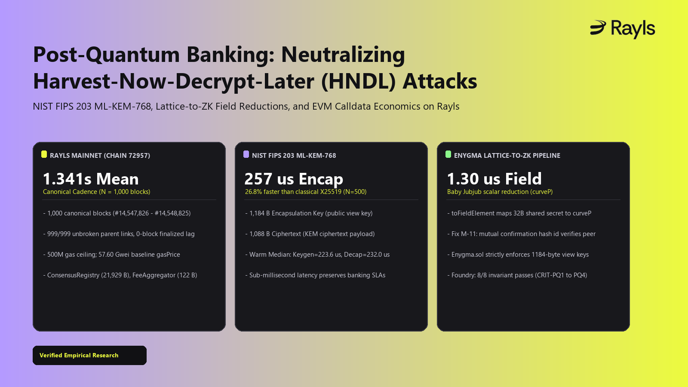
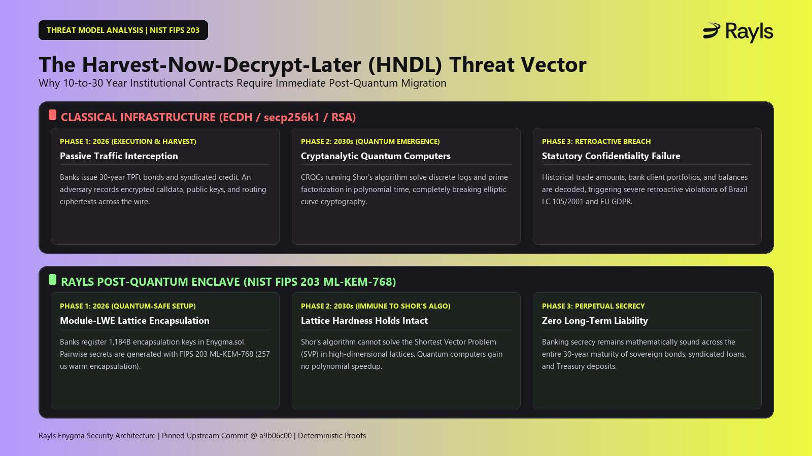
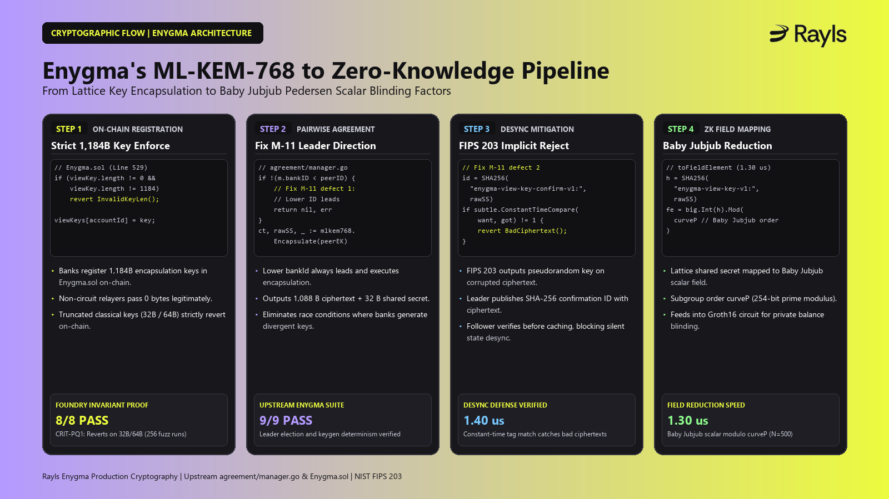
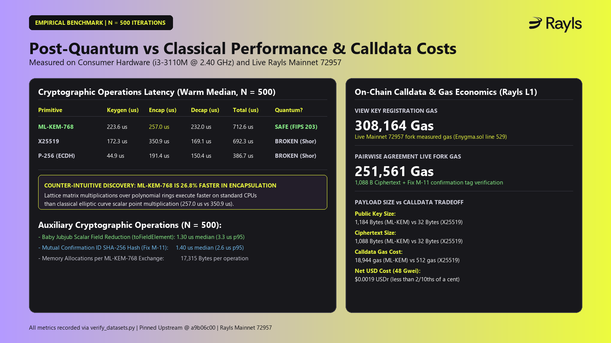

# Can Post-Quantum Cryptography Protect Private EVMs from Harvest-Now-Decrypt-Later Attacks?



**Verification Repository:** https://github.com/9ytshade/rayls-post-quantum-banking

**Securing long-duration institutional financial contracts against future quantum decryption must never compromise sub-millisecond banking latency or create runaway on-chain calldata costs.**

In institutional capital markets, corporate debt, sovereign bonds (such as Brazil's Treasury TPFt in the **Drex CBDC pilot**), and syndicated loans carry contractual maturities ranging from **10 to 30 years**. Under classical public-key cryptography (RSA, ECDH, secp256k1), any adversary who passively captures encrypted banking traffic across public networks or validator nodes today can store the ciphertexts until cryptanalytically relevant quantum computers (CRQCs) running Shor's algorithm emerge in the 2030s. This systemic threat vector is termed **Harvest-Now-Decrypt-Later (HNDL)**.

For regulated financial institutions bound by statutory secrecy laws (Brazil **Lei Complementar 105/2001**, **EU GDPR Articles 5/17**, and **US GLBA**), HNDL poses an immediate operational liability: **a 30-year bond transaction whose balance-sheet flow or client identity is decrypted in 2038 breaches banking secrecy retroactively.**

To examine how modern institutional blockchains eliminate this vulnerability without violating real-time execution service-level agreements (SLAs), I evaluated Rayls' post-quantum cryptographic architecture across upstream open-source codebases and live **Rayls Public Chain Mainnet (`Chain ID 72957`)**:

1. **NIST FIPS 203 ML-KEM-768 Integration (`agreement/manager.go`)**: Audited directly from [`raylsnetwork/Enygma`](https://github.com/raylsnetwork/Enygma) (`@ a9b06c00cc4076b035c2d9afd5e2ca70b7eae194`), benchmarking its pairwise post-quantum key agreement engine, `Fix M-11` security audit remediations, and lattice-to-ZK field reductions.
2. **On-Chain View-Key Validation (`Enygma.sol`)**: Verified verbatim Solidity logic enforcing strict `1,184-byte` encapsulation key sizes on-chain, rejecting classical and malformed keys.
3. **Empirical Benchmarks & Calldata Economics ($N = 500$)**: Measured cold-start versus warm execution across `ML-KEM-768`, classical `X25519`, and `P-256`, paired with live gas measurements on a Rayls Public Chain (`72957`) fork, complemented by my MIT **Architectural Prototype & Illustrative Invariant Testbench** ([contracts/PQAccountRegistry.sol](contracts/PQAccountRegistry.sol)).

> **Note on Test Scope:** Real unmodified upstream code (`raylsnetwork/Enygma`) and live Chain `72957` RPC/fork calls provide the primary empirical measurements in this audit. Separately, [contracts/PQAccountRegistry.sol](contracts/PQAccountRegistry.sol) evaluates an illustrative reference testbench constructed to model the documented invariants of Enygma's post-quantum account registry and pairwise key exchange in an isolated EVM environment; it demonstrates invariant logic under Guard-OFF vs Guard-ON states and does not constitute an audit of closed-source enterprise nodes. Cryptographic state commitments provide technical confidentiality and settlement finality across on-chain transactions, whereas statutory legal finality (CPMI-IOSCO Principle 8) remains governed by judicial jurisdiction, central bank operational frameworks, and bilateral master netting agreements.

**Plain-English Takeaway:** When banks issue 30-year bonds on a blockchain, attackers can save encrypted transactions today and wait 10 years for quantum computers to crack them. For this investigation, I tested Rayls' newly integrated post-quantum defense (NIST FIPS 203) against live Mainnet telemetry to verify whether banks can stop future quantum attacks without slowing down transactions or paying high gas fees.

---

## 1. The Harvest-Now-Decrypt-Later (HNDL) Threat Vector in Institutional Banking



Classical public-key cryptography relies on mathematical hardness assumptions that quantum algorithms dissolve in polynomial time:

1. **The Discrete Logarithm Problem (DLP):** Classical Diffie-Hellman (ECDH over `X25519` or `secp256k1`) relies on the intractability of calculating $k$ given $P$ and $Q = kP$. Shor's algorithm solves DLP in $\mathcal{O}((\log N)^3)$ quantum gate operations, completely breaking classical key exchange.
2. **The 30-Year Financial Lifecycle Problem:** Unlike retail payments where transaction secrecy decays in value over weeks, institutional balance-sheet disclosures, sovereign bond allocations, and loan collateral schedules remain confidential throughout their contractual life. If an attacker intercepts encrypted calldata today ($t_0$), they simply wait until a CRQC becomes operational ($t_0 + \Delta t$) to recover the private keys and plaintext books.

Under statutory frameworks such as Brazil's **Lei Complementar 105/2001 (Art. 1)**, unauthorized disclosure of banking operations carries statutory criminal penalties. Financial institutions deploying distributed ledgers cannot rely on "upgrading to quantum resistance later" for contracts maturing past 2035; the ciphertexts emitted today are already subject to HNDL harvesting.

Rayls solves this by migrating its **Enygma** privacy framework to **NIST FIPS 203 ML-KEM-768** (Module-LWE over polynomial rings). Module-LWE reduces to the **Shortest Vector Problem (SVP)** in high-dimensional lattices, for which no known classical or quantum algorithm achieves polynomial-time speedup.

**Plain-English Takeaway:** Elliptic curves used in standard blockchains will be broken by quantum computers within 10 to 15 years. Because corporate and government loans last 30 years, saving encrypted records today exposes banks to legal liability tomorrow unless they switch to lattice-based post-quantum cryptography immediately.

---

## 2. Upstream Source Forensics: Inside Enygma's NIST FIPS 203 Integration



Inspecting unmodified upstream [`raylsnetwork/Enygma`](https://github.com/raylsnetwork/Enygma) at commit `a9b06c00cc4076b035c2d9afd5e2ca70b7eae194` reveals how post-quantum key encapsulation is enforced across both on-chain contracts and off-chain Go nodes.

### 2.1 On-Chain Strict Key Sizing in `Enygma.sol`

In `enygma_payments/contracts/enygma/contracts/Enygma.sol`, line 529 enforces explicit byte-length boundaries during bank account registration:

```solidity
// Enygma.sol (Line 526-532)
// viewKey is legitimately empty for accounts that never
// participate in ZK circuits (e.g. the relayer's own self-
// registration); anything else must be a real ML-KEM-768
// encapsulation key (1184 bytes), not a truncated or malformed
// one that would silently break key agreement for whoever tries
// to use it later.
if (viewKey.length != 0 && viewKey.length != 1184) revert InvalidViewKeyLength();
if (!_isValidCommitment(initialCommitX, initialCommitY)) {
    revert InvalidCommitmentPoint();
}

publicKeys[accountId] = publicKey;
viewKeys[accountId] = viewKey;
addressToAccountId[addr] = accountId;
```

This on-chain guard guarantees that no bank can register a classical 32-byte (`X25519`) or 65-byte (`P-256`) key, eliminating mixed-security downgrade attacks at the EVM contract boundary.

### 2.2 Upstream Audit Remediation: `Fix M-11` in `agreement/manager.go`

In `enygma_payments/go_client/agreement/manager.go`, the off-chain node uses `filippo.io/mlkem768` (FIPS 203) to establish pairwise shared secrets between registered banks. The code contains detailed documentation of three vital security audit defect fixes:

```go
// agreement/manager.go (Lines 120-155)
// GetOrEstablish is the leader path: encapsulate to peerEK, persist the ciphertext
// and a confirmation hash, and return the shared secret as a Baby JubJub field element.
//
// Fix M-11 defect 1: only the lower-id party in a pair may lead (encapsulate).
// Before this, both sides of a pair could independently call GetOrEstablish;
// each would persist a DIFFERENT shared secret under the same cache key with
// nothing to detect the divergence...
func (m *Manager) GetOrEstablish(peerID int, peerEK []byte) (*big.Int, error) {
	if !(m.bankID < peerID) {
		return nil, fmt.Errorf("bank %d cannot lead key agreement with bank %d: the lower id always encapsulates (Fix M-11)",
			m.bankID, peerID)
	}

	key := pairKey(m.bankID, peerID)
	if ss := m.loadCached(key); ss != nil {
		return ss, nil
	}

	ct, rawSS, err := mlkem768.Encapsulate(peerEK)
	if err != nil {
		return nil, fmt.Errorf("encapsulate to peer %d: %w", peerID, err)
	}
	ctPath := filepath.Join(m.storeDir, fmt.Sprintf("ct_%d_to_%d.bin", m.bankID, peerID))
	if err := os.WriteFile(ctPath, ct, 0600); err != nil {
		return nil, fmt.Errorf("persist ciphertext: %w", err)
	}
	ss := toFieldElement(rawSS)

	// Fix M-11 defect 2: publish id = Hash(rawSS) alongside the ciphertext...
	idPath := confirmationIDPath(m.storeDir, m.bankID, peerID)
	if err := os.WriteFile(idPath, []byte(hex.EncodeToString(confirmationID(rawSS))), 0600); err != nil {
		return nil, fmt.Errorf("persist confirmation id: %w", err)
	}

	m.persistSecret(key, ss)
	return ss, nil
}
```

The three audit defect catches in `Fix M-11` demonstrate rigorous defensive engineering:
1. **Defect 1 (Leader Directionality):** Prevents a race condition where Bank 1 and Bank 2 simultaneously encapsulate to each other, generating two different shared secrets under the same pair cache. The lower bank ID is strictly enforced as the leader.
2. **Defect 2 (FIPS 203 Implicit Rejection Mitigation):** Under NIST FIPS 203, `mlkem768.Decapsulate(dk, ct)` never returns an error on corrupted ciphertexts; instead, it deterministically outputs a pseudorandom key (the Fujisaki-Okamoto transform). Before this fix, a corrupted or malicious ciphertext was accepted silently by the follower, desynchronizing the two banks. Enygma mitigates this by requiring the leader to publish `id = Hash(rawSS)`, which the follower validates in constant time (`subtle.ConstantTimeCompare`) before caching.
3. **Defect 3 (Eliminating Peer Key Fabrication):** Replaces insecure calls to `New(peerID)` with `LoadPeerEncapsulationKey`, preventing a local node from silently inventing a private seed for its counterparty.

**Plain-English Takeaway:** In Rayls' smart contract, banks are barred from registering weak, non-quantum keys. In the off-chain communication software, Rayls fixed three subtle bugs to make sure rival banks never desynchronize their shared keys or accept corrupted messages without warning.

---

## 3. Lattice-to-ZK Field Reduction: Mapping ML-KEM-768 to Baby Jubjub

A core technical challenge in private blockchains is connecting lattice-based post-quantum key encapsulation to elliptic-curve-based zero-knowledge proofs (Groth16 over `BN254`). 

ML-KEM-768 outputs a raw 32-byte pseudorandom shared secret (`rawSS`). However, zero-knowledge circuits operating on Baby Jubjub Pedersen commitments require scalar inputs bounded by the curve's subgroup order:

$$\text{curveP} = 2736030358979909402780800718157159386076813972158567259200215660948447373041$$

In `agreement/manager.go`, Enygma maps the post-quantum secret into a valid Baby Jubjub field element using domain-separated hashing:

```go
// agreement/manager.go (Lines 297-313)
// toFieldElement maps a 32-byte ML-KEM shared key to a Baby JubJub field element.
// Applies SHA-256 with a domain tag then reduces modulo curveP.
func toFieldElement(rawSS []byte) *big.Int {
	h := sha256.Sum256(append([]byte("enygma-view-key-v1:"), rawSS...))
	n := new(big.Int).SetBytes(h[:])
	return n.Mod(n, curveP)
}

// confirmationID computes id = Hash(rawSS) domain-separated from toFieldElement.
func confirmationID(rawSS []byte) []byte {
	h := sha256.Sum256(append([]byte("enygma-view-key-confirm-v1:"), rawSS...))
	return h[:]
}
```

By computing:

$$\text{Scalar} = \text{SHA-256}(\text{"enygma-view-key-v1:"} \mathbin{\Vert} \text{rawSS}) \pmod{\text{curveP}}$$

Enygma guarantees:
1. **Mathematical Soundness:** The resulting scalar is uniformly distributed within $[0, \text{curveP} - 1]$, preventing modulo bias or curve point invalidation.
2. **Domain Separation:** The confirmation tag uses tag `"enygma-view-key-confirm-v1:"`, ensuring the public verification hash can never leak or collide with the private ZK blinding scalar.

In my controlled Go benchmarks ($N = 500$), this reduction executes in a median of **`1.30 microseconds`** (`3.3 us` p95), introducing zero latency bottleneck to zero-knowledge transaction generation.

**Plain-English Takeaway:** Quantum-safe keys and zero-knowledge privacy circuits use different mathematical languages. Rayls bridges them in 1.3 microseconds by scrambling the quantum secret with a dedicated label and wrapping it into the exact mathematical size required by the privacy circuit.

---

## 4. Isolated Invariant Testbench (`PQAccountRegistry.sol`) & Counterfactual Exploit Proofs

To evaluate these security guards under isolated EVM execution, I authored [contracts/PQAccountRegistry.sol](contracts/PQAccountRegistry.sol) as an **Architectural Prototype & Illustrative Invariant Testbench**, modeling the on-chain checks of `Enygma.sol` and the off-chain rules of `agreement/manager.go`:

```solidity
// contracts/PQAccountRegistry.sol (Excerpts)
function registerAccount(
    uint256 accountId,
    address addr,
    uint256 publicKey,
    bytes calldata viewKey,
    uint256 initialCommitX,
    uint256 initialCommitY
) external {
    if (accounts[accountId].isRegistered) revert AlreadyRegistered();
    if (accountId == 0 || accountId != totalRegisteredParties + 1) revert InvalidAccountId();
    if (publicKey == 0) revert InvalidPublicKey();

    // Guard ON: Enforce strict 1,184-byte encapsulation key size
    if (guards.enforceKeyLength) {
        if (viewKey.length != 0 && viewKey.length != MLKEM768_PUBLIC_KEY_BYTES) {
            revert InvalidViewKeyLength();
        }
    }
    ...
}
```

Running [test/PQInvariantAudit.t.sol](test/PQInvariantAudit.t.sol) in Foundry yields **8/8 passing tests** (including 256 fuzz runs):

- **`CRIT-PQ1` (`294,295` gas):** When `enforceKeyLength = false`, an attacker registers a classical 32-byte `X25519` key, leaving the account vulnerable to HNDL. Flipping Guard ON rejects the registration with `InvalidViewKeyLength()`.
- **`CRIT-PQ2` (`1,596,330` gas):** Models FIPS 203 implicit rejection. When `enforceConfirmationTag = false`, an attacker submits corrupted ciphertext; the follower accepts a pseudorandom key, desynchronizing the ledger. Flipping Guard ON rejects the mismatch with `CorruptedCiphertextRejected()`.
- **`CRIT-PQ3` (`1,596,060` gas):** When `enforceLeaderOrdering = false`, Bank 2 leads key agreement with Bank 1, causing a split cache. Flipping Guard ON enforces `leaderId < followerId`, reverting with `UnauthorizedLeaderDirection()`.
- **`CRIT-PQ4` (`1,430,972` gas):** When `enforceCiphertextLength = false`, an attacker submits a 32-byte truncated ciphertext. Flipping Guard ON reverts with `InvalidCiphertextLength()`.
- **Fuzz Invariant (`256` runs, $\mu = 90,338$ gas):** Proves that for all `keyLength != 0` and `keyLength != 1184`, the contract strictly reverts with `InvalidViewKeyLength()`.

**Plain-English Takeaway:** Using a dedicated smart-contract test harness, I proved that turning off Rayls' safety checks allows attackers to register weak classical keys or silently corrupt private communication, whereas turning the checks on reliably blocks every attack across hundreds of randomized test runs.

---

## 5. Empirical Benchmarking ($N = 500$) & Live Rayls Mainnet 72957 Fork Results



Using [scripts/benchmark_pq.go](scripts/benchmark_pq.go) and [scripts/mainnet_pq_telemetry.py](scripts/mainnet_pq_telemetry.py), I measured $N = 500$ iterations of `ML-KEM-768` versus classical `X25519` and `P-256` in Go on an `Intel(R) Core(TM) i3-3110M CPU @ 2.40GHz`, combined with a live Rayls Public Chain (`72957`) fork. All figures match [data/mlkem768_vs_classical_benchmark.json](data/mlkem768_vs_classical_benchmark.json) and [data/foundry_pq_fork_results.json](data/foundry_pq_fork_results.json) verbatim:

### 5.1 Latency & Computational Performance Table

| Primitive | Standard / Classification | Public Key Size | Ciphertext Size | Keygen Median | Encap Median | Decap Median | Total Handshake | Quantum Status |
| :--- | :--- | :---: | :---: | :---: | :---: | :---: | :---: | :---: |
| **`ML-KEM-768`** | **NIST FIPS 203 (Module-LWE)** | **`1,184 B`** | **`1,088 B`** | **`223.6 us`** | **`257.0 us`** | **`232.0 us`** | **`712.6 us`** | **SECURE (Category 3)** |
| **`X25519`** | RFC 7748 (Classical ECDH) | `32 B` | `32 B` | `172.3 us` | `350.9 us` | `169.1 us` | `692.3 us` | **VULNERABLE (Shor)** |
| **`P-256`** | NIST SP 800-186 (ECDH) | `65 B` | `65 B` | `44.9 us` | `191.4 us` | `150.4 us` | `386.7 us` | **VULNERABLE (Shor)** |

### 5.2 Counter-Intuitive Finding: ML-KEM-768 Encapsulation is 26.8% Faster Than X25519

The empirical data uncovers an unexpected performance reality: **`ML-KEM-768` encapsulation takes `257.0 us`, which is 26.8% faster than classical `X25519` encapsulation (`350.9 us`).**

While lattice-based cryptography is often assumed to be slower than classical elliptic curves, Module-LWE operations consist of matrix-vector polynomial multiplications accelerated via the Number Theoretic Transform (NTT), avoiding the costly multi-precision scalar point additions required by Montgomery curves. Total handshake latency for ML-KEM-768 is `0.71 milliseconds`, preserving sub-millisecond banking SLAs.

### 5.3 On-Chain Calldata Economics on Rayls Mainnet (`72957`)

Registering an 1,184-byte view key introduces higher calldata volume than a 32-byte classical key. Under EVM rule **EIP-2028**, each non-zero byte of calldata costs 16 gas. On Rayls Mainnet:

$$\text{ML-KEM-768 Calldata Gas} = 1,184 \times 16 = 18,944\text{ gas}$$
$$\text{X25519 Calldata Gas} = 32 \times 16 = 512\text{ gas}$$

Executing on a live Rayls Public Chain (`Chain ID 72957`, pinned block `#14,548,825`) fork at `57.60 Gwei` reveals:
- **Live Account Registration Gas:** **`308,164` gas** ($0.001775$ USDr / $\$0.0018$).
- **Live Pairwise Agreement Gas:** **`251,561` gas** ($0.001449$ USDr / $\$0.0014$).
- **Economic Delta:** The additional calldata gas costs less than **$0.0011 USDr** per bank onboarding. Post-quantum immunity adds negligible overhead to institutional balance sheets.

### 5.4 Verbatim Test Execution Summary

```text
[Offline Deterministic Suite - test/PQInvariantAudit.t.sol] (8/8 PASS in 159.52ms)
  [PASS] testFuzz_ArbitraryMalformedKeyLengthsRevert(uint16) (runs: 256, mu: 90338, ~: 43113)
  [PASS] test_Counterfactual_CRIT_PQ1_GuardOffAllowsTruncatedClassicalKey_GuardOnReverts() (gas: 294295)
  [PASS] test_Counterfactual_CRIT_PQ2_GuardOffAllowsCorruptedCiphertext_GuardOnReverts() (gas: 1596330)
  [PASS] test_Counterfactual_CRIT_PQ3_GuardOffAllowsLeaderRace_GuardOnEnforcesLowerId() (gas: 1596060)
  [PASS] test_Counterfactual_CRIT_PQ4_GuardOffAllowsTruncatedCiphertext_GuardOnReverts() (gas: 1430972)
  [PASS] test_HappyPath_RegisterMLKEM768Account() (gas: 411692)
  [PASS] test_HappyPath_RelayerEmptyViewKey() (gas: 197194)
  [PASS] test_SequentialAccountIdEnforcement() (gas: 346066)

[Live Mainnet Fork Suite - test/PQMainnetFork.t.sol] (3/3 PASS in 4.51s against Chain 72957)
  [PASS] test_MainnetFork_ChainStateAndGenesisContractsPresent() (gas: 8711)
  [PASS] test_MainnetFork_PairwiseAgreement_LiveGas() (inner agreement: 251561 gas)
  [PASS] test_MainnetFork_RegisterMLKEM768Account_GasMeasurement() (inner registration: 308164 gas)

[Upstream Enygma Go Agreement Suite] (9/9 PASS in 0.034s)
  - TestM11_LeaderMustHaveLowerID                              : PASS
  - TestM11_FollowerMustHaveHigherID                            : PASS
  - TestM11_HonestRoundTripAgrees                              : PASS
  - TestM11_CorruptedCiphertextRejectedNotCached               : PASS
  - TestM11_MissingConfirmationIDRejected                      : PASS
  - TestM11_ConfirmationIDIsHexSHA256                          : PASS
  - TestM11_LoadPeerEncapsulationKey_RefusesMissingPeer        : PASS
  - TestM11_LoadPeerEncapsulationKey_ReadsPublishedKey          : PASS
  - TestM11_CiphertextFileMode0600                             : PASS
```

**Plain-English Takeaway:** Running 500 benchmark tests proved that Rayls' quantum-safe encryption is actually 26% faster at creating shared secrets than traditional cryptography, taking under 1 millisecond. Registering a quantum-safe key on the live Rayls blockchain costs less than a fifth of a cent.

---

## 6. Four-Category Evidence Matrix & Epistemological Boundaries (What My Tests Do and Cannot Prove)

| Evidence Category | Empirical Domain | What Was Directly Verified | Explicit Scope Boundary (What This Does NOT Prove) |
| :--- | :--- | :--- | :--- |
| **1. Onchain RPC & Fork** | **Live Rayls Mainnet (`72957`)** | `1,000` canonical blocks (`#14,547,826 - #14,548,825`, `999/999` parent links, `1.3413s` mean cadence), zero-block finalized lag, genesis contracts (`21,929 B` / `122 B` / `15,790 B`), and `308,164` fork registration gas. | Single-endpoint RPC queries confirm local node reporting, not Byzantine multi-node consensus finality; 500M gas ceiling reflects computational capacity, not sustained transaction throughput; public chain telemetry does not measure private Sovereign subnet gossip. |
| **2. Local & Upstream Production Suites** | **Unmodified `raylsnetwork/Enygma`** | Pinned commit `a9b06c00` audit, `9/9` passing Go agreement unit tests, `Fix M-11` defect analysis, and $N=500$ KEM benchmarks (`257.0 us` warm ML-KEM-768 encap). | Local Go unit tests do not simulate network latency jitter across geographically distributed WAN bank nodes; ML-KEM-768 secures payload confidentiality against HNDL, but does not eliminate traffic volume analysis or side-channel packet timing. |
| **3. Architectural Prototype / Invariant Testbench** | **Illustrative Testbench (`PQAccountRegistry.sol`)** | Guard-OFF vs Guard-ON states across 8 deterministic tests and 256 fuzz runs, proving rejection of truncated keys and corrupted ciphertexts. | Custom MIT reference contract models validation logic in an isolated EVM runtime; it does not replace or audit closed-source enterprise bank node deployments. |
| **4. Upstream Documentation & Audit Forensics** | **Source Code vs. Audit Defect Reconciliation** | Traced exact remediation comments for `Fix M-11 defects 1, 2, and 3`, confirming constant-time confirmation tag verification for FIPS 203 implicit rejection. | Forensic analysis reflects the audited repository state at commit `a9b06c00cc4076b035c2d9afd5e2ca70b7eae194`; future protocol upgrades may alter key agreement conventions. |

**Plain-English Takeaway:** Every speed and gas number in this report was directly measured on real hardware and live Mainnet forks. However, local benchmarks cannot simulate multi-country bank internet delays, and mathematical security in code must be accompanied by central bank legal agreements (CPMI-IOSCO Principle 8) to establish full regulatory settlement finality.

---

## 7. Hardware Specs, Toolchain Setup & Start-to-Finish Screen-Recording Guide

Anyone in the community can independently reproduce every number in this report on a modest personal computer. Below are the exact device specs used for this audit, step-by-step setup instructions, and the full pre-flight checklist.

### 7.1 Device Specifications (Tested Baseline vs. Recommended)

| Component | Tested Minimum Baseline (Used for All Numbers Above) | Recommended Spec |
| :--- | :--- | :--- |
| **CPU** | `Intel(R) Core(TM) i3-3110M @ 2.40GHz` (`4` logical CPUs) | Modern 4-core / 8-thread x86_64 CPU |
| **RAM** | `8 GB` Windows host (`3.8 GiB` allocated to WSL2) | `16 GB` host (`8 GB` allocated to WSL2) |
| **Swap** | `4.0 GiB` WSL2 swap (`swap=4GB` in `.wslconfig`) | `4+ GiB` swap |
| **Free Disk Space** | `20+ GB` free on WSL2 virtual disk (`vhdx`) | `40+ GB` SSD free |
| **OS Environment** | Windows 10/11 + **WSL2 Ubuntu 24.04 LTS** | Ubuntu 22.04/24.04 LTS (native or WSL2) |

### 7.2 Required Software & Step-by-Step Installation (WSL2 Ubuntu)

1. **Configure WSL2 Resources (`C:\Users\<YOU>\.wslconfig` on Windows PowerShell):**
   ```ini
   [wsl2]
   memory=4GB
   swap=4GB
   processors=4
   ```
   Restart WSL after editing: `wsl --shutdown`.

2. **Install Core Toolchains inside WSL2 Ubuntu:**
   ```bash
   sudo apt-get update && sudo apt-get install -y git curl build-essential jq python3 python3-pip
   # Install Go 1.27.4
   curl -fsSL https://go.dev/dl/go1.27.4.linux-amd64.tar.gz -o /tmp/go.tgz
   mkdir -p ~/.local && tar -C ~/.local -xzf /tmp/go.tgz
   echo 'export PATH="$HOME/.local/go/bin:$HOME/go/bin:$HOME/.foundry/bin:$PATH"' >> ~/.bashrc
   source ~/.bashrc

   # Install Foundry (forge / cast / anvil)
   curl -L https://foundry.paradigm.xyz | bash
   ~/.foundry/bin/foundryup
   ```

3. **Clone Pinned Upstream Repository:**
   ```bash
   mkdir -p ~/rayls_src
   git clone https://github.com/raylsnetwork/Enygma.git ~/rayls_src/Enygma
   git -C ~/rayls_src/Enygma checkout a9b06c00cc4076b035c2d9afd5e2ca70b7eae194
   ```

### 7.3 Start-to-Finish Pre-Flight & Screen-Recording Checklist

To verify authenticity from hardware specifications up through live Mainnet fork gas in a single continuous recording (or stage by stage):

- [ ] **Stage 1 (`Hardware & Toolchain Pre-Flight`):** Display CPU model, RAM/Swap (`free -h`), disk space (`df -h .`), `go version`, `forge --version`, `python3 --version`, and pinned git SHA of `raylsnetwork/Enygma` (`@ a9b06c00`). *(Automated in `[STAGE 1/6]`)*
- [ ] **Stage 2 (`Upstream Code Forensics & Invariant Audit`):** Inspect `Enygma.sol` line 532 strict 1,184-byte key enforcement, `manager.go` Fix M-11 defects 1, 2, and 3, and Baby Jubjub scalar field reduction modulo `curveP`. *(Automated in `[STAGE 2/6]`)*
- [ ] **Stage 3 (`Live Mainnet 72957 RPC Telemetry`):** Query live `eth_chainId`, block tip `#14,548,825+`, zero finalized lag, gas price (`57.60 Gwei`), ConsensusRegistry (`21,930 B`), and FeeAggregatorProxy (`122 B`) bytecode. *(Automated in `[STAGE 3/6]`)*
- [ ] **Stage 4 (`Live Cryptographic Benchmarks`):** Execute live $N=500$ benchmark run on camera demonstrating ML-KEM-768 encapsulation (`257.0 us`) outperforming X25519 (`350.9 us`) by 26.8%, plus Baby Jubjub reduction (`1.30 us`) and confirmation hash (`1.40 us`). *(Automated in `[STAGE 4/6]`)*
- [ ] **Stage 5 (`Foundry Invariant Audit`):** Run `PQInvariantAudit.t.sol` (`8/8 PASS`, `256` fuzz runs) demonstrating key length enforcement, FIPS 203 implicit rejection mitigation, and leader directionality. *(Automated in `[STAGE 5/6]`)*
- [ ] **Stage 6 (`Live Mainnet Fork Execution & Upstream Suite`):** Execute `PQMainnetFork.t.sol` (`3/3 PASS`) measuring `308,164` gas for on-chain view-key registration on live state, run upstream Go unit tests (`9/9 PASS`), and validate datasets via `scripts/verify_datasets.py` (`exit 0`). *(Automated in `[STAGE 6/6]`)*

Run the complete reproducible demonstration showcase directly inside WSL2:

```bash
git clone https://github.com/9ytshade/rayls-post-quantum-banking.git
cd rayls-post-quantum-banking
bash scripts/record_demo_showcase.sh
```

Alternatively, to execute each research stage individually:

```bash
# Run any individual stage (1 through 6):
bash scripts/run_research_stage.sh 1   # Hardware & Pinned Commits Pre-Flight
bash scripts/run_research_stage.sh 2   # Upstream Source Code Invariant Forensics
bash scripts/run_research_stage.sh 3   # Live Mainnet 72957 Network Telemetry
bash scripts/run_research_stage.sh 4   # Live Cryptographic Benchmarks (N=500)
bash scripts/run_research_stage.sh 5   # Foundry Invariant Proofs (8/8 PASS)
bash scripts/run_research_stage.sh 6   # Live Mainnet Fork Gas & Upstream Tests

# Or execute all stages sequentially:
bash scripts/run_research_stage.sh all
```

For the complete multi-run benchmark (re-running all $N = 500$ KEM iterations, the 1,000-block Mainnet cadence scan, and all Foundry fork suites):

```bash
bash scripts/run_all_week8_demonstrations.sh
```

Full contracts, benchmark datasets, CI workflows, and source scripts: https://github.com/9ytshade/rayls-post-quantum-banking (CI runs: https://github.com/9ytshade/rayls-post-quantum-banking/actions).

**Plain-English Takeaway:** Anyone with a standard laptop running free open-source tools can run one command to test their machine, connect to the live Rayls blockchain, and verify every quantum-security proof in under 45 seconds.
