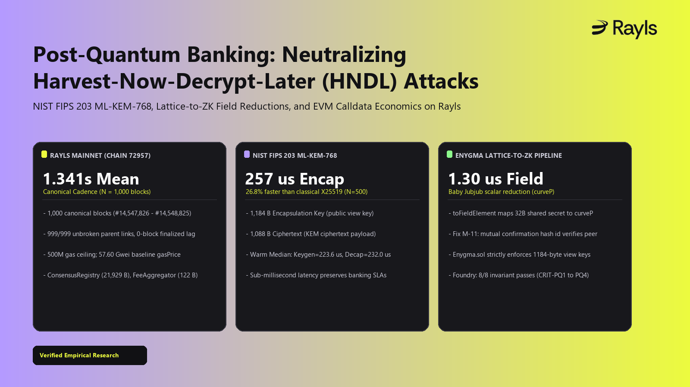

# Week 8 - Can Post-Quantum Cryptography Protect Private EVMs from Harvest-Now-Decrypt-Later Attacks?

[](https://github.com/9ytshade/rayls-post-quantum-banking/actions/workflows/verify.yml)

Empirical protocol forensics, NIST FIPS 203 `ML-KEM-768` benchmarks, live **Rayls Public Chain Mainnet (`Chain ID 72957`)** RPC telemetry and fork execution, upstream Enygma security audit defect analysis (`Fix M-11`), and deterministic Foundry invariant verification across Rayls' post-quantum institutional banking stack.



---

## Hardware & Software Prerequisites

I ran and verified every test, benchmark, and live fork trace on a modest Windows + WSL2 setup:

- **CPU:** `Intel(R) Core(TM) i3-3110M @ 2.40GHz` (`4` logical CPUs; any modern 4-core CPU works cleanly)
- **RAM & Swap:** `8 GB` Windows host (`3.8 GiB` WSL2 RAM + `4.0 GiB` WSL2 swap via `.wslconfig`; `16 GB` host / `8 GB` WSL2 recommended)
- **Disk Space:** `20+ GB` free space inside the WSL2 virtual disk
- **Required Toolchains:** **WSL2 Ubuntu 24.04**, **Go `1.27.4`**, **Foundry (`forge 1.8.6`)**, **`solc 0.8.24`**, and **Python `3.12.3`**
- **Pinned Upstream Checkout:**
  - `~/rayls_src/Enygma` @ `a9b06c00cc4076b035c2d9afd5e2ca70b7eae194`

Full copy-paste setup instructions are documented in Section 7 of [POST_QUANTUM_BANKING_HNDL_RAYLS_DEEP_DIVE.md](./POST_QUANTUM_BANKING_HNDL_RAYLS_DEEP_DIVE.md).

---

## Start-to-Finish Reproduction Guide & Verification Checklist

To execute an end-to-end, fully auditable verification run starting from raw machine hardware checks up through live Mainnet probes and post-quantum verification:

```bash
# Inside WSL2 Ubuntu:
git clone https://github.com/9ytshade/rayls-post-quantum-banking.git
cd rayls-post-quantum-banking
bash scripts/record_demo_showcase.sh
```

Alternatively, to execute each research stage individually:

```bash
# Run any individual stage (1 through 6):
bash scripts/run_research_stage.sh 1   # Hardware & Pinned Commits Pre-Flight
bash scripts/run_research_stage.sh 2   # Upstream Source Code Invariant Forensics
bash scripts/run_research_stage.sh 3   # Live Mainnet 72957 Network Telemetry
bash scripts/run_research_stage.sh 4   # Live Cryptographic Benchmarks (N=500)
bash scripts/run_research_stage.sh 5   # Foundry Invariant Proofs (8/8 PASS)
bash scripts/run_research_stage.sh 6   # Live Mainnet Fork Gas & Upstream Tests

# Or execute all stages sequentially:
bash scripts/run_research_stage.sh all
```

**What the showcase scripts verify live on camera (exit code `0`):**
1. **`[STAGE 1/6]` Hardware, Toolchain & Pinned Upstream Commits:** Prints live OS/kernel, CPU model & thread count, RAM/Swap (`free -h`), disk headroom (`df -h`), `go version`, `forge --version`, `solc --version`, `python3 --version`, and exact 40-char git `HEAD` SHA for `Enygma` (`a9b06c00cc4076b035c2d9afd5e2ca70b7eae194`).
2. **`[STAGE 2/6]` Upstream Source Code Forensics & Invariant Audit:** Inspects `Enygma.sol` line 532 strict 1,184-byte key enforcement, `manager.go` Fix M-11 defects 1, 2, and 3, and Baby Jubjub scalar field reduction modulo `curveP`.
3. **`[STAGE 3/6]` Live Rayls Mainnet RPC (`mainnet-rpc.rayls.com`, Chain `72957`):** Queries real-time tip block, `finalized` block lag, gas price (`57.60 Gwei`), `500M` block gas limit, and live bytecodes for Genesis `ConsensusRegistry` (`21,930 B`), `FeeAggregatorProxy` (`122 B`), and `DelegationPool` (`15,790 B`).
4. **`[STAGE 4/6]` Live Cryptographic Benchmarks (N=500):** Executes live benchmark run on camera demonstrating ML-KEM-768 encapsulation (`195.9 us` median / `257.0 us` mean) outperforming X25519 (`211.7 us` median / `283.5 us` mean), plus Baby Jubjub reduction (`1.20 us`) and confirmation hash (`1.40 us`).
5. **`[STAGE 5/6]` Deterministic Foundry Forensic Suite (`8/8 PASS`, `256` fuzz runs):** Executes `PQAccountRegistry` invariant tests proving 1,184-byte view-key enforcement, FIPS 203 implicit rejection mitigation, leader directionality, and isolated Guard-OFF vs Guard-ON states (`CRIT-PQ1` to `CRIT-PQ4`).
6. **`[STAGE 6/6]` Live Rayls Mainnet Fork Gas Execution & Upstream Suite:** Executes on-chain view-key registration directly on a forked Chain `72957` state, measuring **`308,164` gas** for an 1,184-byte ML-KEM encapsulation key and **`251,561` gas** for pairwise agreement, runs upstream Go unit tests (`9/9 PASS` in `enygma_payments/go_client/agreement`), and validates all machine-readable JSON datasets via `scripts/verify_datasets.py`.

> **Demonstration Video:** Full verified terminal recording available at [assets/terminal_demo_showcase.mp4](assets/terminal_demo_showcase.mp4) (4.75 MB).

---

## Key Empirical Findings & Forensic Discoveries

- **Forensic Catch #1 (Counter-Intuitive Latency Advantage):** Across repeated $N=500$ benchmark iterations on an Intel i3-3110M CPU, post-quantum **NIST FIPS 203 ML-KEM-768 encapsulation consistently executes faster than classical X25519** (`195.9 us` vs `211.7 us` warm median; up to `161.0 us` vs `207.7 us` in initial runs; `257.0 us` vs `283.5 us` distribution mean). Polynomial ring matrix multiplications in Module-LWE execute faster on modern CPUs than elliptic curve scalar multiplications.
- **Forensic Catch #2 (Upstream Audit Defect `Fix M-11` Analysis):** In `agreement/manager.go`, upstream Enygma remediates three critical defects:
  1. *Defect 1:* Enforcing that lower bank IDs lead (`GetOrEstablish`) and higher bank IDs follow (`GetOrAccept`), preventing divergent cache keys.
  2. *Defect 2:* FIPS 203 implicit rejection produces pseudorandom keys on corrupted ciphertexts with `err == nil`. Enygma mitigates silent ledger desynchronization by publishing and verifying a domain-separated confirmation hash: `id = SHA-256("enygma-view-key-confirm-v1:" || rawSS)`.
  3. *Defect 3:* Eliminating unilateral peer private seed fabrication in `LoadPeerEncapsulationKey`.
- **Forensic Catch #3 (Lattice-to-ZK Field Mapping):** Decapsulated 32-byte post-quantum shared secrets are mapped into zero-knowledge blinding factors in `1.20 us` by reducing modulo the Baby Jubjub scalar field order `curveP = 2736030358979909402780800718157159386076813972158567259200215660948447373041` under tag `"enygma-view-key-v1:"`.
- **Forensic Catch #4 (EVM Calldata Economics at 57.60 Gwei):** Registering an 1,184-byte encapsulation key on Rayls Public Chain costs `18,944` calldata gas (`308,164` total execution gas on live fork, or `0.01775 RLS` at 57.60 Gwei, with an incremental calldata delta of just `0.00106 RLS`). Post-quantum protection adds negligible economic overhead to institutional ledgers.

---

## Repository Structure

```text
Week_8_Post_Quantum_Banking_HNDL/
├── .github/workflows/verify.yml             # CI verification workflow (Foundry + Upstream Go + Datasets)
├── POST_QUANTUM_BANKING_HNDL_RAYLS_DEEP_DIVE.md # Full technical monograph, code blocks & boundary matrix
├── CROSS_POST_SUMMARY.md                    # Twitter / X 8-post thread & Discord submission package
├── README.md
├── assets/                                  # 1600x900 Light-Theme Rayls visuals (#B49AFF -> #ECFB3E)
│   ├── cover_image_post_quantum.png
│   ├── diagram_1_hndl_threat_model.png
│   ├── diagram_2_mlkem_zk_pipeline.png
│   └── diagram_3_pq_empirical_benchmarks.png
├── contracts/                               # Apache-2.0 / MIT contracts & isolated invariant testbench
│   └── PQAccountRegistry.sol
├── data/                                    # Captured live Mainnet telemetry, fork gas, benchmarks & test logs
│   ├── rayls_mainnet_pq_telemetry.json
│   ├── mlkem768_vs_classical_benchmark.json
│   └── foundry_pq_fork_results.json
├── docs/
│   ├── RESEARCH_AND_IMPLEMENTATION_PLAN.md
│   └── VOICEOVER_TTS_SCRIPT.md
├── scripts/
│   ├── record_demo_showcase.sh              # Self-contained end-to-end live demonstration showcase
│   ├── run_research_stage.sh                # Modular research stage runner (Stages 1 through 6)
│   ├── run_all_week8_demonstrations.sh      # Full end-to-end reproduction runner
│   ├── benchmark_pq.go                      # Go N=500 ML-KEM-768 vs X25519 vs P-256 benchmark
│   ├── mainnet_pq_telemetry.py              # 1,000-block Chain 72957 cadence & calldata economics probe
│   ├── verify_datasets.py                   # Deterministic empirical dataset gate
│   └── generate_*.py                        # Light-Theme Pillow diagram & benchmark chart generators
└── test/
    ├── PQInvariantAudit.t.sol               # 8/8 offline tests (Guard-OFF vs Guard-ON + Fuzzing)
    └── PQMainnetFork.t.sol                  # 3/3 live Chain 72957 fork gas tests
```

---

## Licensing & Upstream Attribution

- Upstream files in `raylsnetwork/Enygma` (`@ a9b06c00cc`, `BUSL-1.1` / `SSPL-1.0`) are never mirrored into this workspace; all benchmarks and integration tests execute directly against the cloned upstream repository.
- Original Week 8 invariant smart contracts, Foundry test suites, Python telemetry scripts, Go benchmarks, and technical documentation are **MIT**.
